<h1 align="center">Hey there, I'm Abdalla Abdelhameid Zeyada 👋</h1>

<h3 align="center">Back-End .NET Developer | Software Engineer</h3>

  Building reliable, maintainable, and efficient software solutions.

  💻 Back-End .NET Developer passionate about software engineering. 
  🚀 5+ years of learning and technical experience, including 3+ years of hands-on coding and project development. 
  🧠 Strong foundation in C++, C#, OOP, Data Structures, Algorithms, and Databases. 
  ⚙️ Currently focused on C#, .NET, ASP.NET Core, and Entity Framework Core. 
  📚 Always learning, building, and improving.

---

## 🌐 Connect With Me

  
  
  
  

---

## 💻 Tech Stack & Tools

### Programming Languages

  

### Back-End Development

  
  

### Web Technologies

  

### Tools & Platforms

  

---

## 📊 GitHub Statistics

  

---

## 📈 Contribution Activity

  

---

## 🎮 Contribution Pacman

  <picture>
    <source media="(prefers-color-scheme: dark)" srcset="https://raw.githubusercontent.com/abdalla0abdelhamid/abdalla0abdelhamid/pacman-output/pacman-contribution-graph-dark.svg">
    <source media="(prefers-color-scheme: light)" srcset="https://raw.githubusercontent.com/abdalla0abdelhamid/abdalla0abdelhamid/pacman-output/pacman-contribution-graph.svg">
    
  </picture>

---

  

  <i>Always learning. Always building. Always improving. 🚀</i>

